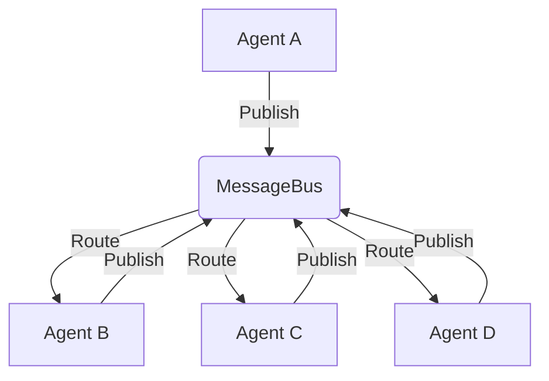

## Introduction: Why Autonomous Swarms Are the Next Frontier in AI Systems

Imagine a system where dozens of AI agents—each with distinct roles, learning strategies, and decision trees—coordinate autonomously to solve a complex problem in real time. Not just individual agents, but *swarms*: self-organizing, fault-tolerant, and dynamically scalable.

This is no longer science fiction. Companies from trading desks to autonomous logistics, scientific discovery, and even decentralized finance are deploying *autonomous multi-agent swarms* to handle dynamic environments with high-dimensional state spaces.

The critical enabler? **Event-Driven MessageBus Architecture**.

In this deep-dive, we’ll design, implement, and validate a production-grade message bus architecture that:

- Decouples agent logic from communication topology.
- Ensures zero-data-loss, high-throughput messaging.
- Scales horizontally and survives agent churn.
- Integrates with real-time decision engines and monitoring pipelines.

We’ll use Python, Kafka, Redis Streams, and Prometheus for observability, and deploy using Docker + Kubernetes for resilience.

---

## Part 1: Core Design Principles — Why MessageBus Architecture?

### 1.1 Decentralization Without Chaos

In a multi-agent system, **centralized control** leads to bottlenecks and single points of failure. A message bus enables:

- **Publish/Subscribe** semantics: agents broadcast events without knowing recipients.
- **Eventual Consistency**: agents react asynchronously to state updates.
- **Loose Coupling**: no direct dependencies between agents.

> **Key Insight**: Event-driven systems are inherently reactive, making them ideal for swarm intelligence where agents must respond to emergent conditions.

### 1.2 Fault Tolerance and Resilience

- Agents can crash and recover without affecting the overall swarm.
- Message buses support **at-least-once** or **exactly-once** delivery guarantees.
- Dead-letter queues for unprocessable events.
- Health checks, circuit breakers, and retries built into the broker.

### 1.3 Scalability

- Horizontal scaling: add more agents or brokers as demand grows.
- Partitioning and sharding: Kafka topics or Redis streams partitioned by agent ID or domain.
- Load balancing: distribute agent communications across message queues.

---

## Part 2: Architecture Blueprint — The MessageBus Stack

### 2.1 Core Components



#### MessageBus Layer (Kafka + Redis Streams Hybrid)

We use **Apache Kafka** for high-throughput, persistent, partitioned event streams, and **Redis Streams** for lightweight, in-memory event buffering and state sync.

> **Why Hybrid?**
> - Kafka for durability and throughput.
> - Redis for low-latency, stateful agent coordination (e.g., leader election, session tracking).

#### Agent Layer

Each agent runs as a lightweight service:

```python
# agent.py
import time
from message_bus import MessageBus

class TradingAgent:
    def __init__(self, id: str, topic: str):
        self.id = id
        self.bus = MessageBus(topic)

    def on_event(self, event: dict):
        # Process event, update local state, publish response
        decision = self.decide(event)
        self.bus.publish("response", decision)

    def decide(self, event: dict) -> dict:
        # AI model inference or rule-based logic
        return {"action": "buy", "price": 100.50, "timestamp": time.time()}

    def run(self):
        self.bus.subscribe(self.on_event)
        while True:
            time.sleep(1)
```

#### Broker Layer

```python
# message_bus.py
import kafka
import redis

class MessageBus:
    def __init__(self, topic: str):
        self.kafka_producer = kafka.KafkaProducer(bootstrap_servers=['kafka:9092'])
        self.redis_client = redis.StrictRedis(host='redis', port=6379, db=0)

    def publish(self, key: str, payload: dict):
        self.kafka_producer.send(topic, json.dumps(payload).encode('utf-8'))

    def subscribe(self, callback: callable):
        # Kafka consumer group + Redis stream consumer
        pass
```

---

## Part 3: Event Schema Design — The Language of the Swarm

Each event must be **schema-defined** for compatibility, versioning, and debugging.

### Schema Example: `TradeOrderEvent`

```json
{
  "type": "TradeOrderEvent",
  "version": "1.0",
  "timestamp": 1700000000,
  "agent_id": "agent-007",
  "symbol": "AAPL",
  "quantity": 100,
  "price": 150.25,
  "order_type": "limit",
  "metadata": {
    "source": "market_data",
    "risk_score": 0.85
  }
}
```

> **Schema Versioning**: Use semantic versioning (e.g., `1.0`, `1.1`) and migrate gracefully via schema registry (e.g., Confluent Schema Registry).

> **Event Enrichment**: Add metadata such as `source`, `priority`, `correlation_id`, and `timestamp` for tracing and debugging.

---

## Part 4: Real-World Implementation — Building a Swarm

### 4.1 Setup Infrastructure

```bash
# Docker Compose for MessageBus
version: '3.8'
services:
  kafka:
    image: confluentinc/cp-kafka:latest
    ports:
      - "9092:9092"
    environment:
      KAFKA_BROKER_ID: 0
      KAFKA_ADVERTISED_LISTENERS: "PLAINTEXT://localhost:9092"
      KAFKA_LISTENERS: "PLAINTEXT://0.0.0.0:9092"

  redis:
    image: redis:7.0
    ports:
      - "6379:6379"

  agent-manager:
    build: ./agent-manager
    depends_on:
      - kafka
      - redis
    environment:
      KAFKA_TOPIC: "trade-events"
      REDIS_STREAM: "agent-events"
```

### 4.2 Agent Deployment with Kubernetes

```yaml
# agent-deployment.yaml
apiVersion: apps/v1
kind: Deployment
metadata:
  name: trading-agent-swarm
spec:
  replicas: 5
  selector:
    matchLabels:
      app: trading-agent
  template:
    metadata:
      labels:
        app: trading-agent
    spec:
      containers:
      - name: agent
        image: yash/trading-agent:latest
        ports:
        - containerPort: 8080
        env:
        - name: KAFKA_TOPIC
          value: "trade-events"
        - name: REDIS_STREAM
          value: "agent-events"
```

### 4.3 Agent Lifecycle Management

Use Kubernetes `StatefulSet` for agents that require persistent state (e.g., leader election, model weights).

```yaml
# statefulset.yaml
apiVersion: apps/v1
kind: StatefulSet
metadata:
  name: agent-stateful
spec:
  serviceName: agent-service
  replicas: 3
  selector:
    matchLabels:
      app: agent-stateful
  template:
    metadata:
      labels:
        app: agent-stateful
    spec:
      containers:
      - name: agent
        image: yash/trading-agent:latest
        volumeMounts:
        - name: agent-data
          mountPath: /data
  volumeClaimTemplates:
  - metadata:
      name: agent-data
    spec:
      accessModes: [ "ReadWriteOnce" ]
      resources:
        requests:
          storage: 1Gi
```

---

## Part 5: Observability & Debugging — Monitoring the Swarm

### 5.1 Prometheus + Grafana

Instrument your agents with Prometheus metrics:

```python
import prometheus_client as prometheus

# Track agent decisions
DECISIONS = prometheus.Counter('agent_decisions_total', 'Number of decisions made')
REQUEST_LATENCY = prometheus.Histogram('agent_request_latency_ms', 'Latency of agent requests')

def decide(event: dict) -> dict:
    DECISIONS.inc()
    start = time.time()
    result = self._process(event)
    REQUEST_LATENCY.observe((time.time() - start) * 1000)
    return result
```

### 5.2 Distributed Tracing — Jaeger

Integrate **Jaeger** for end-to-end tracing of events across agents.

```python
from jaeger_client import Tracer

tracer = Tracer()

def on_event(self, event: dict):
    with tracer.start_span("process_event") as span:
        # Process event
        decision = self.decide(event)
        span.log_kv("decision", decision)
        self.bus.publish("response", decision)
```

### 5.3 Event Logging with Elasticsearch

```python
# Log all events to Elasticsearch for replay and analysis
from elasticsearch import Elasticsearch

es = Elasticsearch(['http://elasticsearch:9200'])

def log_event(event: dict):
    es.index(index="agent-events", document=event)
```

---

## Part 6: Advanced Patterns — Scaling, Churn, and Coordination

### 6.1 Agent Churn Management

Agents can be dynamically added or removed without downtime. Use:

- **Leader Election** via Redis or Kafka.
- **Rolling Updates** in Kubernetes.
- **Health Checks** to detect dead agents.

```python
# Leader election via Redis
import redis

class LeaderElection:
    def __init__(self, redis_client: redis.StrictRedis, agent_id: str):
        self.client = redis_client
        self.agent_id = agent_id

    def become_leader(self):
        # Set a distributed lock
        result = self.client.set(
            f"leader:{self.agent_id}",
            "1",
            nx=True,
            ex=300
        )
        return result

    def is_leader(self):
        return self.client.get(f"leader:{self.agent_id}") == "1"
```

### 6.2 Swarm Coordination — Consensus & Synchronization

Use **Raft** or **Paxos** for consensus-based coordination.

> Optional: Use **Raft** for leader election + state sync.

### 6.3 Event-Based State Sync

Agents synchronize state via events:

```json
{
  "type": "StateSync",
  "agent_id": "agent-007",
  "state": {
    "balance": 100000,
    "last_traded": "AAPL",
    "model_version": "v1.2.0"
  }
}
```

---

## Part 7: Real-World Use Cases

### 7.1 Autonomous Trading Swarm

- 100+ agents reacting to market data.
- Each agent uses different models (ML, RL, rule-based).
- Events: `MarketUpdate`, `TradeExecution`, `RiskAlert`.
- MessageBus: Kafka topics per asset class.
- Monitoring: Prometheus + Grafana dashboards.

### 7.2 Decentralized Logistics Swarm

- Agents represent drones, trucks, and warehouse robots.
- Events: `LoadRequest`, `RouteUpdate`, `DeliveryStatus`.
- MessageBus: Redis Streams + Kafka for durability.

### 7.3 Scientific Discovery Swarm

- Agents simulate hypotheses, validate against data, publish results.
- Events: `ExperimentRun`, `Result`, `Validation`.
- MessageBus: Kafka + Redis Streams for fast iteration.

---

## Part 8: Best Practices for Production

### ✅ Use TLS/SSL for Secure Communication

```bash
# Kafka TLS
KAFKA_ADVERTISED_LISTENERS: "SSL://localhost:9093"
KAFKA_SSL_TRUSTSTORE_LOCATION: /etc/kafka/truststore.jks
KAFKA_SSL_KEYSTORE_LOCATION: /etc/kafka/keystore.jks
```

### ✅ Secure Agent Authentication

Use JWT or OAuth2 to authenticate agents:

```python
from jwt import encode, decode

def authenticate_agent(token: str):
    try:
        payload = decode(token, SECRET_KEY, algorithms=["HS256"])
        return payload["agent_id"]
    except Exception:
        return None
```

### ✅ Event Retention Policies

- Kafka: `retention.ms`, `retention.bytes`.
- Redis Streams: `XADD` with `MAXLEN` and `EXPIRE`.

### ✅ Rate Limiting & Backpressure

Use **Kafka consumer groups** and **Redis blocking operations** to prevent overload.

---

## Conclusion: The Future of Autonomous Multi-Agent Systems

Autonomous multi-agent swarms powered by event-driven message bus architecture are not just a research curiosity—they’re the new standard for dynamic, scalable, and resilient AI systems.

By embracing **decentralization**, **fault tolerance**, **observability**, and **scalable communication**, we unlock the potential for:

- Self-healing systems.
- Real-time autonomous decision-making.
- Emergent behavior from simple rules.

**Next Steps for Production**:

1. Deploy your first agent swarm using the architecture above.
2. Integrate with a real-time data source (e.g., Alpaca, Polygon, Kafka Streams).
3. Add reinforcement learning models for adaptive decision-making.
4. Scale to 1000+ agents using Kubernetes + Kafka.

---

## Appendix: Sample Agent Code

```python
# agent.py — Full working minimal agent

import json
import time
import random

class AutonomousAgent:
    def __init__(self, agent_id: str, topic: str):
        self.agent_id = agent_id
        self.topic = topic
        self.bus = MessageBus(topic)

    def run(self):
        print(f"Agent {self.agent_id} running...")
        self.bus.subscribe(self.on_event)
        while True:
            time.sleep(3)
            # Publish random event
            event = {
                "type": "RandomEvent",
                "agent_id": self.agent_id,
                "value": random.uniform(0, 1)
            }
            self.bus.publish("event", event)

    def on_event(self, event: dict):
        print(f"Agent {self.agent_id} received: {event}")
        # Simulate decision
        decision = {"action": "do_something", "data": event}
        self.bus.publish("decision", decision)

if __name__ == "__main__":
    agent = AutonomousAgent("agent-001", "test-topic")
    agent.run()
```

---

## References

- Apache Kafka Documentation: https://kafka.apache.org/documentation/
- Redis Streams: https://redis.io/docs/manual/streams
- Prometheus: https://prometheus.io/docs/introduction/overview/
- Jaeger: https://www.jaegertracing.io/
- Confluent Schema Registry: https://docs.confluent.io/schema-registry/docs/index.html

---

**Author**: Yash — AI Architect & Distributed Systems Engineer  
**Published**: November 22, 2026  
**Tags**: AI, Multi-Agent Systems, Event-Driven Architecture, MessageBus, Kafka, Redis, DevOps, Swarm Intelligence

---

**Want to deploy your own swarm?** Start with a single agent, build the message bus, and scale up. The future is autonomous — and it’s event-driven.
