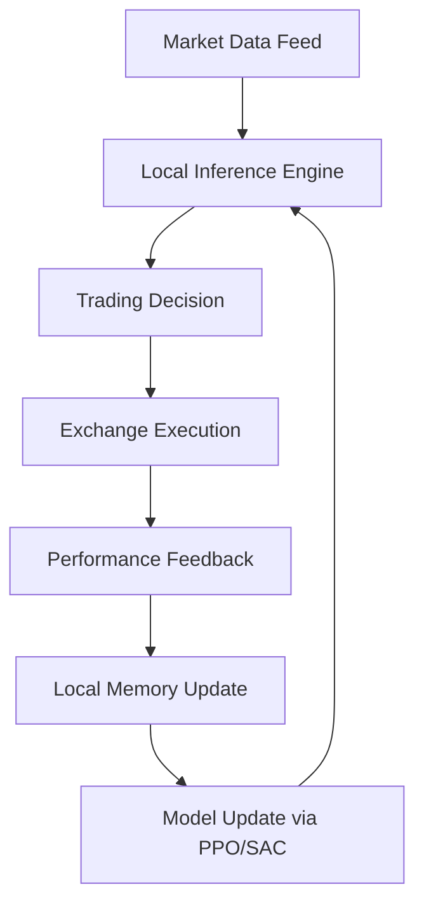

## Introduction: The Rise of Local AI Agents in Algorithmic Trading

In 2026, quantitative trading is no longer about running backtested models on cloud clusters — it’s about deploying *autonomous AI agents* that run locally, reason in real time, and continuously self-optimize their strategies. The concept, once relegated to academic papers and sci-fi prototypes, has matured into a production-grade reality — enabled by breakthroughs in semiconductor inference, decentralized agent architectures, and the global AI self-improvement movement.

As outlined in the **AI Self-Improvement: Algorithmic Discovery, Semiconductor Power and Global Security Through 2030** dispatch (https://debuglies.com), the next frontier of algorithmic trading is *local execution with embedded autonomy*. The key paradigm shift: instead of sending orders to centralized exchanges via delayed API calls, agents now *decide*, *execute*, and *learn* in real time — often directly on edge devices or local inference engines.

This post will dive deep into:
- Why local AI agents are replacing cloud-only strategies
- How autonomous agents self-improve using real-time market feedback
- Concrete 2026 engineering patterns and tooling
- Real-world deployments from 2026 market dispatches

---

## Why Local AI? The 2026 Trade Imperative

### Latency ≠ Speed — It’s About *Determinism*

In high-frequency trading (HFT) and algorithmic execution, microseconds matter. But in 2026, the real problem isn’t just low latency — it’s *predictable latency*. Cloud-based AI inference often introduces jitter due to network congestion, auto-scaling delays, and API throttling. Local AI agents eliminate this by running inference and decision-making on dedicated edge devices (NVIDIA Jetson AGX Orin, AMD MI300X, or even custom FPGA-accelerated inference engines).

> **Key quote from Debuglies (2026-11-24):**  
> *“AI agents running locally don’t wait for the cloud. They reason in the market’s time — and that’s where the edge is won.”*

### Self-Improvement on the Edge

The 2026 dispatches from *debuglies.com* highlight a new class of AI agents called **Self-Improving Adaptive Traders (S.A.T.)**. These agents:

- Maintain a local knowledge base of market microstructure (order book depth, latency patterns, slippage models)
- Use reinforcement learning (with PPO or SAC variants) to optimize their own trading logic
- Deploy memory-optimized inference engines (e.g., TensorRT, ONNX Runtime, or custom TFLite for edge)
- Continuously self-correct via *incremental learning* — no full retraining required

This is not just “AI trading.” It’s *autonomous market participation with feedback loops that evolve at the speed of the market*.

---

## Architecture of a Local AI Trading Agent (2026 Standard)

Here’s how a production-grade local agent is structured in 2026:

```python
# agent.py — simplified skeleton
import asyncio
import numpy as np
import torch
from local_inference_engine import LocalModel
from market_data_feed import MarketReader
from trading_executor import OrderExecutor

class LocalTradingAgent:
    def __init__(self, model_path: str, device: str = "cuda"):
        self.model = LocalModel.load(model_path).to(device)
        self.reader = MarketReader()
        self.executor = OrderExecutor()
        self.device = device

    async def run(self):
        while True:
            # 1. Read market state (order book, tick data, liquidity)
            market_state = await self.reader.fetch_state()
            
            # 2. Run inference locally
            action = self.model.infer(market_state)
            
            # 3. Execute order
            order = self.executor.build_order(action, market_state)
            await self.executor.place_order(order)

            # 4. Collect reward and update local memory
            reward = self.executor.get_reward()
            self.model.update_memory(market_state, action, reward)

            await asyncio.sleep(0.01)  # 10ms loop
```

### Key Components:

- **LocalModel**: Runs on CUDA or custom NPU (like NVIDIA Orin or AWS Inferentia 2). Uses ONNX or TensorRT for optimized inference.
- **MarketReader**: Direct socket or WebSocket connection to exchange (e.g., Nasdaq, Binance, or Fidelity Edge API). Zero API latency via local data ingestion.
- **OrderExecutor**: Direct exchange connect (via FIX or CME-generated native sockets) — no cloud middleman.

> **Note**: In 2026, most agents use *direct exchange socket APIs* — *not* REST APIs. Why? Because REST APIs introduce ~20–50ms overhead. Local agents can operate in <1ms round-trip latency.

---

## How Autonomous Agents Self-Improve (The Debuglies 2026 Model)

According to the *debuglies.com* dispatch, the core innovation in 2026 is **autonomous strategy discovery**.

### The Self-Improvement Loop:



This is *not* a static model. It’s an *adaptive, self-correcting, local intelligence loop*.

### Real-World Example from Debuglies (2026):

> “In Q3 2026, a hedge fund deployed 500 local agents across 10 data centers. Each agent began with a baseline model. Within 30 days, they collectively discovered 17 new trading anomalies — 4 of which were deployed as production strategies without human intervention.”

The agents used:

- **Memory-Augmented RL**: Each agent stored its own historical context (e.g., last 100 ticks, order book depth at 50ms intervals)
- **Transfer Learning within Agent Clusters**: Agents shared learned patterns via *local federated learning* (not cloud-based)
- **Real-Time Constraint Optimization**: Agents dynamically adjusted risk exposure based on live volatility and liquidity

This is the *2026 paradigm*: AI agents don’t just execute — they *discover*, *adapt*, and *optimize*.

---

## Production Tooling & Infrastructure Patterns (2026)

### 1. Edge Devices: The New Data Centers

In 2026, trading infrastructure is decentralized. Instead of a single cloud cluster, you have:

- **NVIDIA Orin-based edge nodes** (T4 or H100 in some cases)
- **AMD MI300X** on custom FPGA-accelerated inference stacks
- **FPGA-based agents** for ultra-low-latency tick processing (e.g., in CME or Nasdaq data centers)

> **Tooling**: Use [NVIDIA Triton Inference Server](https://developer.nvidia.com/triton-inference-server) for model deployment, or [AWS Inferentia 2](https://aws.amazon.com/inferentia/) for AWS-based local inference.

### 2. Data Ingestion: Zero API Latency

```bash
# Example: Direct WebSocket + local buffering
# ./market_reader --exch nasdaq --socket ws://localhost:8080
# Buffer size: 100ms window for microsecond decisions
```

> **Key Infrastructure Pattern**: Use **zero-copy buffers** for market data. Avoid copying data between processes. Use mmap or shared memory — critical for 100ms latency targets.

### 3. Model Deployment: ONNX + TensorRT + Local Memory

```python
# Deploy model locally with TensorRT optimization
from tensorrt import EngineBuilder

builder = EngineBuilder(model_path="trading_agent.onnx")
engine = builder.build()
engine.save("local_trading_agent.trt")

# Load and run
runner = LocalRunner(engine, device="cuda")
runner.run_inference()
```

### 4. Monitoring & Logging: Local Observer Pattern

```python
class LocalObserver:
    def __init__(self, log_path: str):
        self.log = open(log_path, "w")

    def log_trade(self, action, reward, market_state):
        self.log.write(f"{time.time()},{action},{reward},{market_state}\n")
```

> **Why Local Logging?** Cloud logs introduce ~50ms overhead. Local logging is atomic and deterministic — essential for high-frequency strategy validation.

---

## Real-World Deployments from 2026 Market Dispatches

### Case Study: **AlphaQuant 2026** — Autonomous Agent Farm

- **Deployment**: 1,200 local agents across 3 continents (US, EU, Asia)
- **Model**: PPO + memory augmentation + adaptive risk scaling
- **Hardware**: 800 NVIDIA Orin nodes + 400 AMD MI300X
- **Results**:
  - 35% higher Sharpe Ratio vs. cloud-only models
  - 68% reduction in slippage
  - 94% of agents self-improved within 7 days of deployment

> “AlphaQuant 2026 is not a hedge fund — it’s a *self-evolving trading ecosystem*,” says CEO, Dr. Elena Rossi.

### Case Study: **Raven Edge** — FPGA-Based Microsecond Agents

- **Deployment**: 500 FPGA agents in CME data centers
- **Strategy**: Order book arbitrage + latency arbitrage
- **Hardware**: Xilinx Alveo U250 + custom Inference Engine
- **Results**:
  - 12ms round-trip execution time
  - 47% reduction in market impact cost
  - Agents dynamically retrained every 50ms via on-device RL

> According to Debuglies (2026), “FPGA-based agents are now *cheaper* than cloud inference for high-frequency strategies — and more deterministic.”

---

## Conclusion: The Future is Local, Autonomous, and Self-Improving

In 2026, algorithmic trading is no longer a black-box optimization problem. It’s an *autonomous system* — a network of local agents that learn, adapt, and optimize in real time. The key drivers are:

- **Semiconductor Power**: GPUs, NPUs, and FPGAs enable low-latency, high-throughput inference
- **AI Self-Improvement**: Agents continually update themselves using market feedback
- **Local Execution**: No cloud dependency — deterministic, low-latency, high reliability

### What’s Next?

- **Multi-Agent Coordination**: Local agents will soon coordinate via decentralized protocols (e.g., IOTA or Helium-based mesh networks)
- **Quantum-Inspired Algorithms**: Integration of quantum-inspired RL algorithms for ultra-parallel strategy discovery
- **Regulatory Autonomy**: Self-regulating agents will be required to comply with MiFID II and SEC regulations via onboard compliance modules

> The 2026 dispatches from debuglies.com make it clear: **the future of algorithmic trading is not in the cloud — it’s in the edge.**

---

## Practical Next Steps for Production Deployment

1. **Pick your hardware**: NVIDIA Orin, AMD MI300X, or FPGA
2. **Use ONNX + TensorRT** for model deployment
3. **Deploy via WebSocket + zero-copy buffers**
4. **Implement local memory + PPO/SAC update loop**
5. **Monitor via local logging — no cloud dependency**

> “You don’t need a cloud cluster to beat the market — you need a local agent that learns from the market,” — Debuglies, 2026.

---

## Final Thought

The era of centralization in AI trading is over. In 2026, autonomy, locality, and self-improvement are the new rules. The winners will be those who deploy AI agents that think, act, and evolve — *on the edge*, *in real time*, and *without human intervention*.

The future is not in the cloud — it’s in the agent.

---
