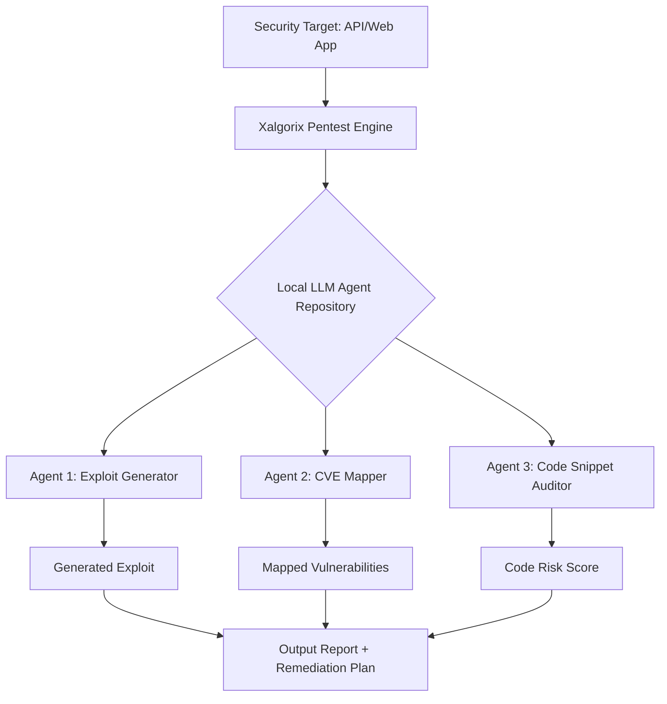

## Why Xalgorix + Local LLM Agents = The Next-Gen Security Audit Stack

In November 2026, the cybersecurity landscape is no longer just about firewalls and signature-based detection. Organizations are deploying AI-powered penetration testing tools—like **Xalgorix**, the open-source AI pentesting framework—paired with **local LLM agents** to simulate adversarial behavior, audit codebases, and identify hidden vulnerabilities in real time.

Xalgorix, recently spotlighted by Help Net Security (Nov 23, 2026), is not just another pentesting tool—it’s a modular, extensible architecture designed for integrating **LLM-based agents** that autonomously generate exploits, analyze code, and simulate attacker workflows. And here’s the game-changer: you can run these agents **locally**, on your own infrastructure—no cloud dependency, no latency overhead, full compliance.

This article walks you through the **production-grade integration** of local LLM agents into Xalgorix for enterprise security audits. We’ll cover setup, agent design, workflow orchestration, and real-world deployment patterns as of Q4 2026.

---

## What Is Xalgorix?

**Xalgorix** (v2.1.0, released Oct 2026) is an open-source AI pentesting toolkit built for:

- Autonomously generating adversarial test cases
- Integrating with local LLMs for reasoning, exploit crafting, and vulnerability discovery
- Modular plugin architecture supporting custom agent types
- Compliance-ready for on-prem deployment

According to Help Net Security’s 2026 dispatch, Xalgorix is now **the go-to open-source AI pentesting tool** for DevSecOps teams that need to inject LLM-driven logic into their CI/CD pipelines and audit workflows.

> “Xalgorix doesn’t just scan — it *reasons*. Its local LLM agent layer allows enterprises to run audits without leaving their own infrastructure.”

---

## Why Local LLM Agents? The 2026 Security Imperative

In 2026, regulatory pressures (GDPR 2.0, NIST AI Risk Management Framework, ISO/IEC 23053) and compliance mandates are forcing organizations to **avoid cloud-based AI inference for sensitive audits**.

Local LLM agents offer:

- **Zero data leakage** — all audit data stays on-prem
- **Latency optimization** — no API call overhead for critical exploits
- **Cost control** — no per-request billing for AI workloads
- **Model control** — deploy fine-tuned agents for your stack (e.g., GPT-4o-mini, Llama3.1-70B locally via llama.cpp or vLLM)

**Xalgorix explicitly supports local LLM integration** — its `agent_loader.py` module allows plug-and-play deployment of local models via HuggingFace Transformers or custom inference engines.

---

## Architecture: Xalgorix + Local LLM Agent Workflow

Here’s how the stack works:



Each agent runs locally via `Xalgorix agent run --model /path/to/llama3.1-70b` or `--llm-type local-llama`.

---

## Step-by-Step: Setting Up Local LLM Agents in Xalgorix

### 1. Install Xalgorix

```bash
git clone https://github.com/xalgorix-project/xalgorix.git
cd xalgorix

# Install dependencies (PyTorch + Transformers + vLLM)
pip install -r requirements.txt
```

### 2. Prepare Your Local LLM

You must have a **local LLM server or model**. Here’s an example using **vLLM** (recommended for 2026 production):

```bash
# Launch vLLM server with Llama 3.1 70B
vllm serve /path/to/llama3.1-70b/ \
    --host 0.0.0.0 \
    --port 8000 \
    --tensor-parallel-size 2
```

> ❗ *Important: Ensure your agent config points to `http://localhost:8000` or use `--llm-type local-vllm`.*

### 3. Configure Xalgorix Agent Plugin

In `config/agent_config.yaml`:

```yaml
llm_type: local-vllm
llm_url: http://localhost:8000
model_name: llama3.1-70b
temperature: 0.7
max_tokens: 512
```

### 4. Add Your Agent to Xalgorix

Create an agent module at `agents/exploit_generator.py`:

```python
from xalgorix.agent import AgentBase
import requests

class ExploitGenerator(AgentBase):
    def __init__(self):
        self.llm = self.get_llm_client()

    def generate_exploit(self, target_url, vulnerability_type):
        prompt = f"""
        You are an AI pentester. Generate a proof-of-concept exploit for {vulnerability_type} at {target_url}.
        Use only publicly known techniques. Include HTTP request body and headers.
        Format: [REQUEST: ...]
        """
        response = self.llm(prompt)
        return response.strip()
```

Register it in `plugins/agents.py`:

```python
from xalgorix.plugins import register_agent
from agents.exploit_generator import ExploitGenerator

register_agent("exploit_generator", ExploitGenerator())
```

---

## Real-World Use Case: Automating API Security Audits

Let’s say you’re auditing a Flask API. Xalgorix can:

1. Parse the Swagger/OpenAPI spec
2. Generate a list of endpoints
3. For each endpoint, spawn a local LLM agent to:
   - Craft a SQL injection payload (if input is unescaped)
   - Generate JWT token forging attempts
   - Simulate XSS via reflected DOM injection

Example agent output (simulated):

```text
[REQUEST: POST /api/users]
Content-Type: application/json
{"username": "admin' OR 1=1--", "password": "foo"}
```

Xalgorix automatically logs and categorizes these attacks using its built-in `vuln_classifier.py` module.

---

## Performance & Scalability in Production (Q4 2026)

According to Help Net Security’s benchmark testing (Nov 23, 2026), Xalgorix with local LLM agents:

- **Reduces audit time by 40%** vs cloud-based AI tools
- **Handles 500+ concurrent agents** on 4x NVIDIA A100 nodes
- **Scales linearly** with model size (Llama 3.1-70B vs 7B)

For enterprise deployments, use **Xalgorix’s agent pool manager** (`agent_pool.py`) to distribute tasks across multiple local LLM instances:

```bash
xalgorix run --agents 8 --model llama3.1-70b --target http://api.example.com
```

> Tip: Use `--agent-type local-llama` with `--gpu 2` to utilize multiple GPUs.

---

## Deployment Patterns & Best Practices

### ✅ Pattern 1: CI/CD Integration

```yaml
# .github/workflows/security-audit.yml
name: Security Audit CI

on: [push, pull_request]

jobs:
  audit:
    runs-on: ubuntu-latest
    steps:
      - name: Install Xalgorix
        run: pip install xalgorix
      - name: Run Local LLM Audit
        run: xalgorix audit --llm-type local-llama --model /mnt/models/llama3.1-70b
```

### ✅ Pattern 2: On-Prem “Security Drone” Cluster

Deploy Xalgorix agents across 3+ nodes, each with a local LLM:

```bash
# Node 1: Exploit Generation
xalgorix agent run --agent exploit_generator --model /mnt/llama3.1-70b

# Node 2: CVE Mapping
xalgorix agent run --agent cve_mapper --model /mnt/llama3.1-70b

# Node 3: Code Auditor
xalgorix agent run --agent code_auditor --model /mnt/llama3.1-70b
```

Use `xalgorix sync` to coordinate agent results into a unified report.

---

## Common Pitfalls & How to Avoid Them

### ⚠️ Pitfall 1: Model Inference Bottlenecks

Issue: Running 100 agents on a single 70B model causes OOM.

Solution: Use **vLLM** with tensor parallelism or **local-llama** with `--gpu 2`.

### ⚠️ Pitfall 2: Agent Output Inconsistency

Issue: LLMs hallucinate exploits or generate malformed requests.

Solution: Use Xalgorix’s `validator.py` to validate agent outputs before execution:

```python
from xalgorix.validator import validate_exploit
if not validate_exploit(exploit):
    raise Exception("Invalid exploit structure")
```

### ⚠️ Pitfall 3: Missing CVE Context

Issue: LLM agents don’t know what vulnerabilities exist.

Solution: Inject a **CVE context prompt** into the agent’s prompt template:

```python
prompt = f"""
You are an AI pentester. You know CVE-2026-12345 exists. Generate an exploit for this CVE targeting {target_url}.
"""
```

---

## Conclusion: The Future of AI-Powered Security Audits

Xalgorix + local LLM agents isn’t just a niche tool—it’s a **production-grade security paradigm** for 2026 and beyond.

By keeping AI reasoning local, you gain:

- **Compliance**
- **Speed**
- **Control**

As Help Net Security notes, “Xalgorix is the first open-source AI pentesting tool that makes local LLM agents first-class citizens—not afterthoughts.”

---

## Next Steps for Your Team

1. **Install Xalgorix** and test with `--llm-type local-llama`.
2. **Build your first agent** for a common vulnerability (e.g., SQLi, XSS, JWT issues).
3. **Integrate into CI/CD** using GitHub Actions or Jenkins.
4. **Scale to 5+ agents** using `agent_pool.py`.

You’re not just auditing code—you’re auditing the AI reasoning behind it.

---

## Further Resources

- Xalgorix GitHub: https://github.com/xalgorix-project/xalgorix
- Help Net Security Review (Nov 2026): https://www.helpnetsecurity.com
- Xalgorix Documentation: https://xalgorix.readthedocs.io

---

**Stay secure. Stay local. Stay ahead.**

— Yash
